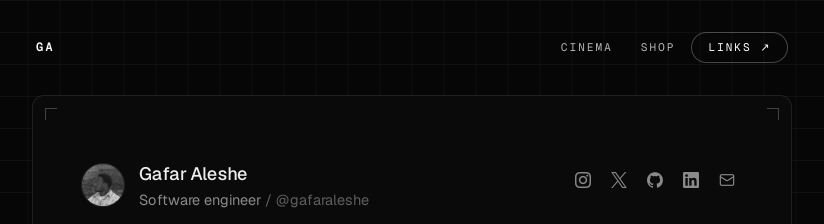
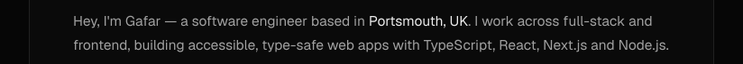
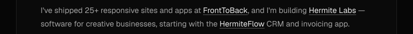
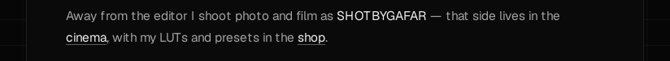
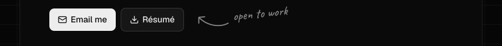
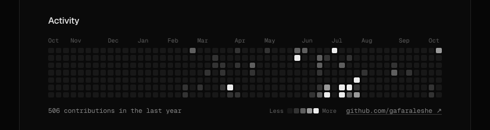
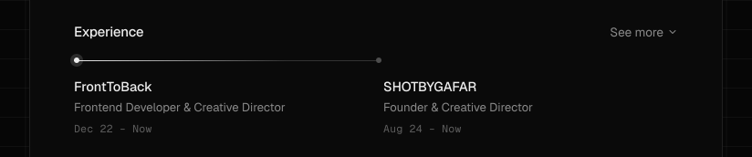
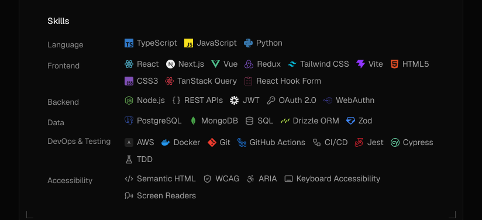
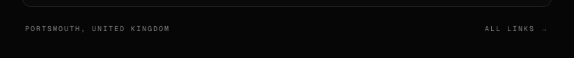

<!--
  Generated by scripts/build.mjs: the top of gafaraleshe.com as stacked image
  strips (desktop and mobile). Edit the script, then run npm run build.
-->

<a href="https://gafaraleshe.com"><picture><source media="(max-width: 1199px)" srcset="assets/mobile/01-header.svg"></picture></a>
<a href="https://gafaraleshe.com"><picture><source media="(max-width: 1199px)" srcset="assets/mobile/02-intro-1.svg"></picture></a>
<a href="https://hermitelabs.com"><picture><source media="(max-width: 1199px)" srcset="assets/mobile/03-intro-2.svg"></picture></a>
<a href="https://gafaraleshe.com/cinema"><picture><source media="(max-width: 1199px)" srcset="assets/mobile/04-intro-3.svg"></picture></a>
<a href="mailto:contact@gafaraleshe.com"><picture><source media="(max-width: 1199px)" srcset="assets/mobile/05-buttons.svg"></picture></a>
<a href="https://github.com/gafaraleshe"><picture><source media="(max-width: 1199px)" srcset="assets/mobile/06-activity.svg"></picture></a>
<a href="https://gafaraleshe.com/#experience"><picture><source media="(max-width: 1199px)" srcset="assets/mobile/07-experience.svg"></picture></a>
<a href="https://gafaraleshe.com/#skills"><picture><source media="(max-width: 1199px)" srcset="assets/mobile/08-skills.svg"></picture></a>
<a href="https://gafaraleshe.com/links"><picture><source media="(max-width: 1199px)" srcset="assets/mobile/09-footer.svg"></picture></a>

