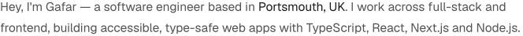
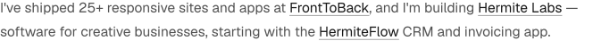
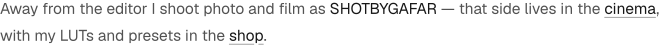
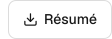

<!--
  The top of gafaraleshe.com, drawn as images so it keeps the site's type and
  colours. Each image has a dark and a light version in assets/; rebuild them
  with `npm install && npm run build` after changing scripts/build.mjs.
-->

<a href="https://gafaraleshe.com"><picture><source media="(prefers-color-scheme: dark)" srcset="assets/dark/avatar.png"></picture></a><a href="https://gafaraleshe.com"><picture><source media="(prefers-color-scheme: dark)" srcset="assets/dark/intro.svg"></picture></a><a href="https://instagram.com/gafaraleshe"><picture><source media="(prefers-color-scheme: dark)" srcset="assets/dark/instagram.svg"></picture></a><a href="https://x.com/GafarAleshe"><picture><source media="(prefers-color-scheme: dark)" srcset="assets/dark/x.svg"></picture></a><a href="https://github.com/gafaraleshe"><picture><source media="(prefers-color-scheme: dark)" srcset="assets/dark/github.svg"></picture></a><a href="https://www.linkedin.com/in/gafaraleshe/"><picture><source media="(prefers-color-scheme: dark)" srcset="assets/dark/linkedin.svg"></picture></a><a href="mailto:contact@gafaraleshe.com"><picture><source media="(prefers-color-scheme: dark)" srcset="assets/dark/mail.svg"></picture></a>

<a href="https://gafaraleshe.com"><picture><source media="(prefers-color-scheme: dark)" srcset="assets/dark/bio-1.svg"></picture></a>

<a href="https://hermitelabs.com"><picture><source media="(prefers-color-scheme: dark)" srcset="assets/dark/bio-2.svg"></picture></a>

<a href="https://gafaraleshe.com/cinema"><picture><source media="(prefers-color-scheme: dark)" srcset="assets/dark/bio-3.svg"></picture></a>

<a href="mailto:contact@gafaraleshe.com"><picture><source media="(prefers-color-scheme: dark)" srcset="assets/dark/email.svg"></picture></a><a href="https://gafaraleshe.com/assets/Gafar_Aleshe_Resume.pdf"><picture><source media="(prefers-color-scheme: dark)" srcset="assets/dark/resume.svg"></picture></a><picture><source media="(prefers-color-scheme: dark)" srcset="assets/dark/open-to-work.svg"></picture>

